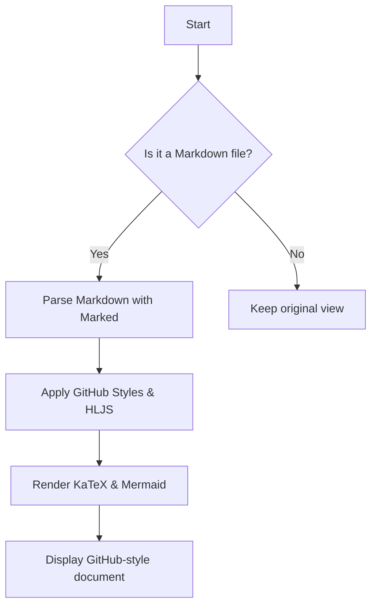
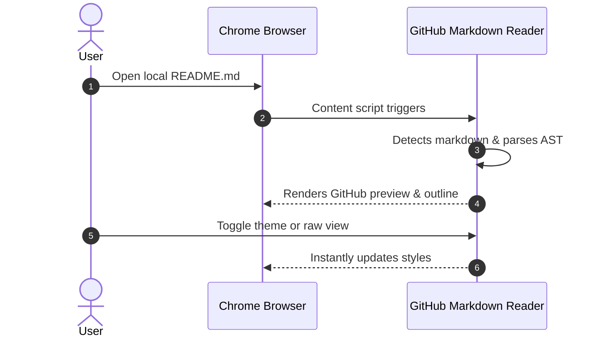

# GitHub Markdown Reader Showcase :rocket:

Welcome to the **GitHub Markdown Reader** extension! This document showcases all GitHub-flavored Markdown features rendered with fidelity to GitHub.

---

## Document Outline & Navigation :books:

Use the **Outline** button in the top toolbar to open the table of contents drawer. As you scroll through this document, the active section will automatically highlight!

---

## GitHub Alerts :bulb:

GitHub supports five special alert callouts to emphasize critical information:

> [!NOTE]
> Useful information that users should take into account, even when skimming.

> [!TIP]
> Helpful advice for doing things better or more easily.

> [!IMPORTANT]
> Key information users need to know to achieve their goal.

> [!WARNING]
> Urgent info that needs immediate user attention to avoid problems.

> [!CAUTION]
> Advises about risks or negative outcomes of certain actions.

---

## Code Blocks & Syntax Highlighting :zap:

Hover over any code block to copy the code snippet with a single click:

### TypeScript

```typescript
interface UserProfile {
  id: string;
  username: string;
  email: string;
  role: 'admin' | 'contributor' | 'viewer';
}

function formatUserGreeting(user: UserProfile): string {
  return `Hello, ${user.username}! You are logged in as ${user.role}.`;
}

console.log(formatUserGreeting({
  id: "u-101",
  username: "octocat",
  email: "octocat@github.com",
  role: "admin"
}));
```

### Python

```python
import math
from typing import List

def calculate_stats(numbers: List[float]) -> dict:
    """Calculates mean, variance, and standard deviation."""
    if not numbers:
        return {}
    mean = sum(numbers) / len(numbers)
    variance = sum((x - mean) ** 2 for x in numbers) / len(numbers)
    return {
        "mean": round(mean, 4),
        "variance": round(variance, 4),
        "std_dev": round(math.sqrt(variance), 4)
    }

print(calculate_stats([12.5, 18.2, 14.7, 22.0, 19.3]))
```

### Shell / Bash

```bash
# Clone and build the project
git clone https://github.com/example/repo.git
cd repo
npm install
npm run build
```

---

## Mathematical Equations (LaTeX via KaTeX) :art:

Inline equations: The mass-energy equivalence is defined as $E = mc^2$, and the Euler identity is $e^{i\pi} + 1 = 0$.

Block display equations:

$$\int_{-\infty}^{\infty} e^{-x^2} dx = \sqrt{\pi}$$

$$\sum_{k=1}^{n} k^3 = \left( \frac{n(n+1)}{2} \right)^2$$

$$\mathbf{A} = \begin{pmatrix} a_{11} & a_{12} \\ a_{21} & a_{22} \end{pmatrix}$$

---

## Mermaid Diagrams :bar_chart:

Mermaid code blocks automatically render as interactive SVG diagrams:





---

## GitHub Task Lists :white_check_mark:

- [x] Implement Manifest V3 architecture
- [x] GitHub alert blocks (`[!NOTE]`, `[!TIP]`, `[!WARNING]`, etc.)
- [x] Syntax highlighting with GitHub Light & Dark themes
- [x] One-click copy code snippet button
- [x] Document outline sidebar with scrollspy
- [x] KaTeX mathematical formula rendering
- [x] Mermaid diagram support
- [x] Dark / Light / System theme toggle
- [ ] Add custom font family selector

---

## Data Tables :clipboard:

| Feature | Support | Engine | Description |
| :--- | :---: | :---: | :--- |
| **GFM Tables** | :heavy_check_mark: | Marked | Responsive tables with striped rows |
| **Syntax Highlighting** | :heavy_check_mark: | Highlight.js | Automatic language detection & themes |
| **Alerts** | :heavy_check_mark: | Custom Plugin | Note, Tip, Important, Warning, Caution |
| **Math** | :heavy_check_mark: | KaTeX | Fast LaTeX formula rendering |
| **Diagrams** | :heavy_check_mark: | Mermaid | Flowcharts, sequences, state diagrams |
| **Outline** | :heavy_check_mark: | Built-in | Dynamic TOC with scrollspy |

---

## Typography & Formatting

You can use standard markdown formatting:

* *Italic text* or _Italic text_
* **Bold text** or __Bold text__
* ~~Strikethrough text~~
* `Inline code`
* [GitHub](https://github.com) hyperlinks

### Nested Lists

1. Step 1: Install extension
   * Download or clone repository
   * Open `chrome://extensions`
2. Step 2: Enable Developer Mode
   * Click **Load unpacked**
   * Select the `dist/` directory
3. Step 3: Enjoy GitHub Markdown anywhere! :tada:
